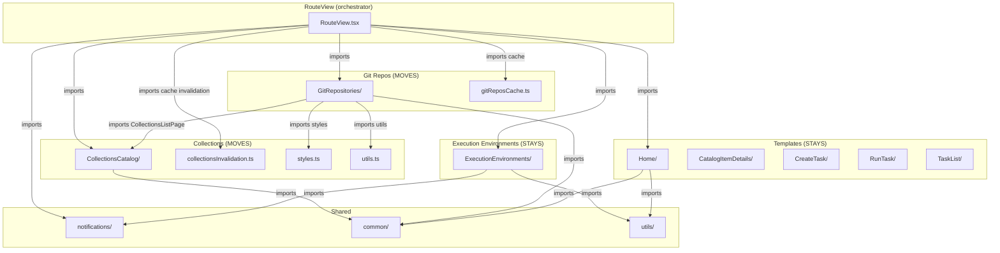

# Portal Plugin Factory — Research: self-service (portal-scaffolder)

> **Jira:** [AAP-96042](https://redhat.atlassian.net/browse/AAP-96042) — Portal Plugin Factory - Research: self-service (CollectionsCatalog, ExecutionEnvironments, GitRepositories etc)
> **Parent epic:** [AAP-95616](https://redhat.atlassian.net/browse/AAP-95616) — ANSTRAT-2497 Research Spikes
> **Parent initiative:** [ANSTRAT-2497](https://redhat.atlassian.net/browse/ANSTRAT-2497) — Portal Plugin Factory: Plugin Development Guide and SDK
> **Assignee:** Shatakshi Mishra
> **Status:** In Progress

---

## Objective

Research and plan the rework of the self-service frontend plugin (`@ansible/portal-scaffolder`) to comply with the ANSTRAT-2497 Portal Plugin Factory architecture: produce a full component inventory, identify module boundaries for content extraction, determine how each page section becomes an independently exportable dynamic contribution, align scaffolder field ownership with the scaffolder re-architecture spike ([AAP-95782](https://redhat.atlassian.net/browse/AAP-95782)), and document the migration path for dynamic plugin registration, URL stability, and the content/self-service boundary (implementation guide §6 / §7).

---

## Context

Today the `portal-scaffolder` plugin (`workspaces/self-service/plugins/self-service/`) is a monolith that bundles five distinct functional domains under a single Backstage frontend plugin. It registers one plugin ID (`portal-scaffolder`) and serves all routes under `/self-service/*`.

The Content Experience Architecture (§7.1) and the implementation guide (Phase 6) call for extracting content-browsing pages (Collections Catalog, Git Repositories, Execution Environments built-image view) into the content workspace (ANSTRAT-1758). Abhinav Anand's architectural guidance adds that:

1. Plugins must operate **independently** without requiring modifications to core code.
2. A new **content discovery plugin** will house Git Repositories, the Collection Catalog, and Execution Environment discovery.
3. Each tab/page in self-service must be **exportable** so it hooks into the dynamic plugin configuration file automatically.

This spike de-risks the extraction and re-architecture before implementation stories are opened, and produces a decision record the team can act on.

---

## Current Architecture — What the Plugin Contains

### Plugin Identity

| Field             | Value                          |
| ----------------- | ------------------------------ |
| Package name      | `@ansible/portal-scaffolder`   |
| Plugin ID         | `portal-scaffolder`            |
| Backstage role    | `frontend-plugin`              |
| Location          | `workspaces/self-service/plugins/self-service/` |
| Routes root       | `/self-service/*`              |
| Manifest          | `selfServiceManifest.ts`       |

### Functional Domains

The plugin currently bundles **five functional domains**. Each domain is a logical group of components, routes, and data sources.

#### Domain 1 — Templates & Scaffolder (core self-service)

The reason this plugin exists. Users browse job template catalogs, launch scaffolder workflows, and review task history.

| Component             | Route                                         | Permission                 | Data source           |
| --------------------- | --------------------------------------------- | -------------------------- | --------------------- |
| `HomeComponent`       | `/self-service/catalog`                       | `templatesViewPermission`  | `ansibleApiRef`       |
| `CatalogItemsDetails` | `/self-service/catalog/:ns/:templateName`     | `templatesViewPermission`  | Catalog API           |
| `CreateTask`          | `/self-service/create/templates/:ns/:tplName` | `templatesViewPermission`  | Scaffolder API        |
| `TaskList`            | `/self-service/create/tasks`                  | `historyViewPermission`    | Scaffolder API        |
| `RunTask`             | `/self-service/create/tasks/:taskId`          | `historyViewPermission`    | Scaffolder API        |
| `CatalogImport`       | `/self-service/catalog-import`                | `catalogEntityCreate` + superuser | Catalog API    |

**Verdict:** Stays in `portal-scaffolder`. This is the core identity of the plugin.

#### Domain 2 — Execution Environments

EE definition catalog, EE detail view (with extension tabs), and EE build/create flow.

| Component         | Route                                    | Permission                            | Data source        |
| ----------------- | ---------------------------------------- | ------------------------------------- | ------------------ |
| `EETabs`          | `/self-service/ee/catalog`, `/ee/create` | `executionEnvironmentsViewPermission` | Catalog API        |
| `EEDetailsPage`   | `/self-service/catalog/:templateName`    | `executionEnvironmentsViewPermission` | Catalog API        |
| `CreateContent`   | (sub-component of EETabs)                | `executionEnvironmentsViewPermission` | `eeBuildApiRef`    |
| `EEBuildSession`  | (sub-component of EEDetailsPage)         | `executionEnvironmentsViewPermission` | `eeBuildApiRef`    |

**Notes:** The implementation guide (Phase 6) distinguishes EE **definitions** (authoring; stays in self-service) from EE **built images** (content browsing; moves to content workspace). The EE create flow and definition catalog likely stay; the built image view may move.

**Verdict:** Partially stays (definition authoring), partially moves (built image browsing). Needs detailed component-level decision.

#### Domain 3 — Collections Catalog

Browsing and viewing Ansible collections synced from Private Automation Hub.

| Component                | Route                                         | Permission                 | Data source |
| ------------------------ | --------------------------------------------- | -------------------------- | ----------- |
| `CollectionsCatalogPage` | `/self-service/collections`                   | `collectionsViewPermission`| Catalog API |
| `CollectionDetailsPage`  | `/self-service/collections/:collectionName`   | `collectionsViewPermission`| Catalog API |
| `CollectionAboutCard`    | (sub-component)                               | —                          | Catalog API |
| `CollectionReadmeCard`   | (sub-component)                               | —                          | SCM API     |
| `CollectionResourcesCard`| (sub-component)                               | —                          | Catalog API |

**Verdict:** Moves to content discovery plugin (ANSTRAT-1758 dependency). Phase 6 extraction target.

#### Domain 4 — Git Repositories

Browsing git repositories, CI activity, repository detail pages with extension tabs.

| Component                | Route                                            | Permission                      | Data source |
| ------------------------ | ------------------------------------------------ | ------------------------------- | ----------- |
| `GitRepositoriesPage`    | `/self-service/repositories/catalog`             | `gitRepositoriesViewPermission` | Catalog API |
| `RepositoriesCIActivityTab` | `/self-service/repositories/ci-activity`      | `gitRepositoriesViewPermission` | Catalog API + SCM |
| `RepositoryDetailsPage`  | `/self-service/repositories/:repositoryName`     | `gitRepositoriesViewPermission` | Catalog API |
| `RepositoryAboutCard`    | (sub-component)                                  | —                               | Catalog API |
| `RepositoryReadmeCard`   | (sub-component)                                  | —                               | SCM API     |

**Verdict:** Moves to content discovery plugin. Phase 6 extraction target. The detail page already supports extension tabs from the registry.

#### Domain 5 — Infrastructure & Shell Components

Components that don't belong to any content domain — they are portal/auth infrastructure.

| Component         | Purpose                                      | Candidate destination         |
| ----------------- | -------------------------------------------- | ----------------------------- |
| `LandingPage`     | Just a `<Navigate to="/self-service" />`     | `portal-core` (portal-theme)  |
| `SignInPage`      | AAP OAuth sign-in page                       | `aap` workspace               |
| `AAPLogoutButton` | Revokes AAP token, ends session              | `aap` workspace               |
| `AAPLogoutHandler`| Session cleanup logic                        | `aap` workspace               |
| `AppThemeFixer`   | MUI theme correction                         | `portal-core`                 |
| `LocationListener`| URL/location tracking                        | Evaluate need — may be dead   |

**Verdict:** Extract to appropriate workspace. None of these belong in portal-scaffolder.

### Scaffolder Field Extensions (11 total)

| # | Extension name                       | Data source / AAP dependency | Category       |
|---|--------------------------------------|------------------------------|----------------|
| 1 | `AAPTokenFieldExtension`             | AAP OAuth token              | AAP-specific   |
| 2 | `AAPResourcePickerExtension`         | AAP API (resources)          | AAP-specific   |
| 3 | `BaseImagePickerExtension`           | Catalog API (EE base images) | EE-authoring   |
| 4 | `CollectionsPickerFieldExtension`    | Catalog API (collections)    | Content-bridge |
| 5 | `FileUploadPickerFieldExtension`     | Local (no API)               | Generic        |
| 6 | `PackagesPickerFieldExtension`       | Catalog API (packages)       | Content-bridge |
| 7 | `MCPServersPickerFieldExtension`     | Catalog API / config         | Generic        |
| 8 | `AdditionalBuildStepsPickerExtension`| Local (no API)               | EE-authoring   |
| 9 | `EEFileNamePickerFieldExtension`     | Local (no API)               | EE-authoring   |
| 10| `EETagsPickerFieldExtension`         | Catalog API (EE tags)        | EE-authoring   |
| 11| `ScmSelectorFieldExtension`          | Config (SCM providers)       | Generic        |

**Cross-reference with [AAP-95782](https://redhat.atlassian.net/browse/AAP-95782):** The scaffolder spike proposes extracting reusable field UI into `self-service-react` and splitting content-bridge pickers (CollectionsPicker, BaseImagePicker) to the content workspace once ANSTRAT-1758 operations ship.

### API Factories (3 total)

| API ref            | ID                              | Connects to              | Candidate owner          |
| ------------------ | ------------------------------- | ------------------------ | ------------------------ |
| `ansibleApiRef`    | `ansible`                       | Catalog backend (sync)   | `aap` workspace frontend |
| `eeBuildApiRef`    | `plugin.self-service.ee-build`  | Catalog backend (EE build) | Self-service or content |
| `rhAapAuthApiRef`  | `ansible.auth.rhaap`            | Auth backend (OAuth)     | `aap` workspace frontend |

### Permission Dependencies

| Permission                            | Used by                  | Defined in             |
| ------------------------------------- | -------------------------| ---------------------- |
| `executionEnvironmentsViewPermission` | EE pages, sidebar        | `backstage-rhaap-common` |
| `collectionsViewPermission`           | Collections pages, sidebar | `backstage-rhaap-common` |
| `gitRepositoriesViewPermission`       | Git repo pages, sidebar  | `backstage-rhaap-common` |
| `templatesViewPermission`             | Templates pages, sidebar | `backstage-rhaap-common` |
| `historyViewPermission`               | History pages, sidebar   | `backstage-rhaap-common` |
| `catalogEntityCreatePermission`       | Catalog import           | `@backstage/plugin-catalog-common` |

### Sidebar Items (5 total)

Each sidebar item is a `createComponentExtension` that checks permissions before rendering.

| Sidebar item                  | Permission                            | Route target                     |
| ----------------------------- | ------------------------------------- | -------------------------------- |
| `TemplatesSidebarItem`        | `templatesViewPermission`             | `/self-service/catalog`          |
| `HistorySidebarItem`          | `historyViewPermission`               | `/self-service/create/tasks`     |
| `EEBuilderSidebarItem`        | `executionEnvironmentsViewPermission` | `/self-service/ee`               |
| `CollectionsSidebarItem`      | `collectionsViewPermission`           | `/self-service/collections`      |
| `GitRepositoriesSidebarItem`  | `gitRepositoriesViewPermission`       | `/self-service/repositories`     |

### Manifest Capabilities (selfServiceManifest.ts)

Currently declares 4 capabilities with 6 entry points:

1. **`portal-scaffolder.collection-detail`** — Overview tab for collections
2. **`portal-scaffolder.repository-detail`** — Overview + CI Activity tabs for repositories
3. **`portal-scaffolder.ee-definition-detail`** — Overview tab for EE definitions
4. **`portal-scaffolder.repository-list`** — Catalog + CI Activity page-tabs for repo list

### Extension Host Integration

- `DynamicExtensionDiscovery` is mounted in `RouteView` with `[selfServiceManifest]`
- Detail pages use `useExtensionTabs` to render third-party tabs (e.g., APME quality tab)
- All extension host code lives in `portal-extension-host`; self-service has thin re-export shims in `src/extensions/`

### Direct Dependencies (`package.json`)

| Dependency                          | Purpose                           | Stays with portal-scaffolder? |
| ----------------------------------- | --------------------------------- | ----------------------------- |
| `@ansible/backstage-rhaap-common`   | Permissions, types                | Yes (reduced surface)         |
| `@ansible/portal-plugin-sdk`        | Shared UI, hooks, theme           | Yes                           |
| `@ansible/portal-extension-api`     | Registry, hooks (peerDep)         | Yes (peerDep)                 |
| `@ansible/portal-extension-host`    | Rendering runtime (peerDep)       | Yes (peerDep)                 |
| `@backstage/plugin-scaffolder`      | Scaffolder API                    | Yes                           |
| `@backstage/plugin-scaffolder-react`| Scaffolder field extensions       | Yes (if fields stay)          |
| `@backstage/plugin-catalog-react`   | Entity pages, catalog hooks       | Evaluate after extraction     |
| `@material-ui/core` + `@mui/*`      | UI components                     | Yes                           |
| `@rjsf/core` + utils + validator    | JSON Schema forms (scaffolder)    | Yes                           |

---

## What Has Been Done

* Plugin renamed from `@ansible/plugin-backstage-self-service` to `@ansible/portal-scaffolder` (plugin ID: `portal-scaffolder`).
* `selfServiceManifest.ts` declares capabilities for collection detail, repository detail, EE definition detail, and repository list.
* Extension host shims created in `src/extensions/` — thin re-exports from `@ansible/portal-extension-host`.
* `DynamicExtensionDiscovery` mounted in `RouteView.tsx` with first-party manifest.
* Detail pages (Repository, Collection, EE) wired to `useExtensionTabs` — third-party contributions (e.g., APME Quality tab) render without compile-time imports.
* Repository list page wired with extension tab support — `useExtensionTabs(GIT_REPO_LIST_TABS)`.
* Common components extracted to `@ansible/portal-plugin-sdk` (Phase 1 complete): `PageHeaderSection`, `SyncDialog`, `EmptyState`, `NotificationProvider`, `PaginatedEntityCache`, `useIsSuperuser`, etc.
* `syncPollingService` refactored for DI — `addInvalidator(fn)` replaces hardcoded cache imports.
* `portal-extension-api` and `portal-extension-host` declared as `peerDependencies` — not bundled in `dist-dynamic`.
* `portal-core` frontend-plugin provides the `ContributionRegistry` singleton in RHDH MF shared scope ([AAP-95778](https://redhat.atlassian.net/browse/AAP-95778)).
* All tests passing: 196 suites, 3961 tests; tsc and lint clean.

---

## What Remains

### ~~R1 — Component-Level Extraction Plan~~ ✅ DONE (see I1)

Full component-level inventory with per-component stays/moves/extracts decisions completed.

### ~~R2 — Dynamic Exportable Tab/Page Architecture~~ ✅ DONE (see I3)

Dynamic export surface designed. `plugin.ts` already defines individually mountable extensions. `dynamic/index.ts` design documented; `dynamic-plugins.yaml` target config documented.

### R3 — Content Discovery Plugin Boundary — DECISION NEEDED

Options documented in I4. **Team must decide: Option A (single plugin, recommended), B (per-type), or C (defer to ANSTRAT-1758).** This is the highest-priority decision blocking implementation.

### ~~R4 — Scaffolder Field Extension Ownership~~ ✅ DONE (see I5)

11 fields classified. 7 stay, 2 move to `aap`, 2 blocked on ANSTRAT-1758.

### ~~R5 — API Factory Refactoring~~ ✅ DONE (see I7)

All 3 API factories mapped to backend routes. `ansibleApiRef` and `eeBuildApiRef` stay; `rhAapAuthApiRef` moves to `aap` workspace (pending AAP-95802).

### ~~R6 — Route and URL Stability Plan~~ ✅ DONE (see I6)

All 16 routes classified. 10 stay, 6 move with redirect shims.

### R7 — RHDH Dynamic Plugin Configuration — PARTIALLY DONE (see I3)

Target `dynamic-plugins.yaml` snippet documented. Full operator migration guide needs writing after Phase D.

### ~~R8 — Test Migration Strategy~~ ✅ DONE (see I8)

196 suites classified by domain. ~30 test files move with content extraction. 4 e2e specs move. 3 cross-domain tests need refactoring. Estimated 4–6 days total test work.

---

## Research Questions

1. ~~What is the minimal portal-scaffolder surface after full content extraction — templates + scaffolder + task history + EE definition authoring only?~~ **ANSWERED** (see I1 — all EE components stay; EE built-image browsing doesn't exist yet)
2. ~~How should each page section (Templates, History, EE, Collections, Repos) become individually exportable via dynamic plugin configuration?~~ **ANSWERED** (see I3 — individual `createRoutableExtension` per section, already in `plugin.ts`)
3. Should content discovery be one plugin or per-content-type plugins? Who owns it — the self-service team or the content team (ANSTRAT-1758)? **→ TEAM DECISION NEEDED** (see I4 — Option A recommended)
4. ~~Which of the 11 scaffolder field extensions stay with portal-scaffolder vs move to `aap` vs move to content workspace?~~ **ANSWERED** (see I5 — 7 stay, 2 to `aap`, 2 to content)
5. ~~Where do API factories (`ansibleApiRef`, `eeBuildApiRef`, `rhAapAuthApiRef`) live after the split?~~ **ANSWERED** (see I7 — ansibleApiRef + eeBuildApiRef stay; rhAapAuthApiRef → `aap`)
6. ~~How do sidebar items register dynamically — does each extracted section carry its own sidebar item, or does the host manage sidebar assembly?~~ **ANSWERED** (see I3 — each section carries its own sidebar item via `createComponentExtension`)
7. ~~How does `selfServiceManifest.ts` evolve — does it shrink to only templates/EE-authoring capabilities, or does each extracted section publish its own manifest?~~ **ANSWERED** (see I3 — content capabilities move to content plugin manifest; portal-scaffolder manifest shrinks)
8. ~~What URL stability guarantees are required for `/self-service/*` routes? Can content pages move to `/content/*` routes with redirects?~~ **ANSWERED** (see I6 — redirect stubs in portal-scaffolder for one release cycle)
9. ~~What is the EE authoring vs EE browsing boundary at the component level? Which sub-components of `ExecutionEnvironments/` stay?~~ **ANSWERED** (see I1 — all 39 EE files are definition authoring; built-image browsing doesn't exist yet)
10. ~~How do `syncPollingService` invalidators (collections cache, git repos cache) work after those caches move to other plugins?~~ **ANSWERED** (see I2 — each plugin registers its own invalidators via `addInvalidator()` on mount; sync polling service stays in portal-scaffolder)
11. What RHDH `dynamic-plugins.yaml` config changes do operators need for the reworked plugin(s)? **PARTIALLY ANSWERED** (see I3 — portal-scaffolder snippet documented; content plugin snippet depends on R3 decision)
12. ~~What is the dependency on ANSTRAT-1758 for content extraction, and what work can proceed independently?~~ **ANSWERED** — All of Phases B, C, and D can proceed independently. Only E2 (content-bridge picker rewrite) and final content ownership transfer are blocked.

---

## Investigation Findings

### I1 — Complete Component Inventory (DONE)

Full directory-level inventory of `src/components/`, `src/hooks/`, `src/utils/`, `src/extensions/`.
The plugin contains **295 source files** across **24 component directories**.

#### Domain-level summary

| Domain | Directory | Files | ~LOC | Functional domain | Verdict |
|---|---|---|---|---|---|
| **Templates & Scaffolder** | `Home/` | 24 | 4,209 | Template catalog, pagination, search | **STAYS** |
| | `CatalogItemDetails/` | 5 | 657 | Template detail page | **STAYS** |
| | `CreateTask/` | 13 | 5,951 | Scaffolder form wrapper | **STAYS** |
| | `RunTask/` | 5 | 4,118 | Running task view | **STAYS** |
| | `TaskList/` | 3 | 855 | History/task list | **STAYS** |
| | `CatalogImport/` | 3 | 132 | Catalog import | **STAYS** |
| | `UnregisterEntityDialog/` | 5 | 1,080 | Entity unregister | **STAYS** |
| **Execution Environments** | `ExecutionEnvironments/` | 39 | 11,403 | EE catalog + create + detail | **SPLIT** (see below) |
| **Collections Catalog** | `CollectionsCatalog/` | 31 | 9,131 | Collections browsing | **MOVES** to content discovery |
| **Git Repositories** | `GitRepositories/` | 32 | 9,406 | Repository browsing | **MOVES** to content discovery |
| **Scaffolder Fields** | `Scaffolder/` | 62 | 16,687 | 11 field extensions | **MIXED** (see R4 table) |
| **Infrastructure** | `SignInPage/` | 3 | 99 | AAP OAuth sign-in | **MOVES** to `aap` |
| | `AAPLogoutButton/` | 3 | 266 | AAP logout button | **MOVES** to `aap` |
| | `AAPLogoutHandler/` | 3 | 258 | Session cleanup | **MOVES** to `aap` |
| | `AppThemeFixer/` | 1 | 2 | MUI theme fix | **MOVES** to `portal-core` |
| | `LandingPage/` | 2 | 32 | Redirect to /self-service | **MOVES** to `portal-core` |
| | `LocationListener/` | 2 | 159 | URL tracking | **EVALUATE** — may be dead |
| **Shared/Cross-cutting** | `SidebarItems/` | 3 | 759 | 5 permission-gated sidebar items | **STAYS** (reduced to 3) |
| | `feedback/` | 4 | 636 | FeedbackFooter | **STAYS** |
| | `notifications/` | 8 | 3,557 | NotificationProvider, sync polling | **STAYS** |
| | `common/` | 6 | 447 | Re-exports from portal-plugin-sdk | **STAYS** |
| | `utils/` | 6 | 956 | TagFilterPicker, SourcePicker, tar utils | **STAYS** |
| | `RouteView/` | 3 | 585 | Central route hub | **REFACTORED** |

#### Non-component source

| Path | Files | ~LOC | Purpose |
|---|---|---|---|
| `src/plugin.ts` | 1 | 238 | Plugin registration (createPlugin, routable extensions) |
| `src/apis.ts` | 1 | 388 | 3 API factories (ansibleApiRef, eeBuildApiRef, rhAapAuthApiRef) |
| `src/routes.ts` | 1 | 43 | Route refs (root, ee, collections, gitRepositories, templates, history) |
| `src/selfServiceManifest.ts` | 1 | 148 | 4 capability contributions, 6 entry points |
| `src/index.ts` | 1 | 24 | Public exports |
| `src/hooks/` | 2 | 230 | `useIsSuperuser`, `useSyncStatusPolling` |
| `src/utils/` | 4 | 760 | `eeDefinitionUtils`, `timeUtils` |
| `src/extensions/` | 5 | 41 | Thin re-export shims from `portal-extension-host` |
| `src/tests/` | 3 | ~400 | Test utilities and mock data |

#### EE authoring vs EE browsing split

The `ExecutionEnvironments/` directory (39 files, ~11,403 LOC) needs a component-level split:

| Sub-path | Components | Purpose | Verdict |
|---|---|---|---|
| `catalog/CatalogContent.tsx` | EE definition list with filtering | Browsing definitions (authoring context) | **STAYS** |
| `catalog/EEDetailsPage.tsx` | EE definition detail page | Detail view with extension tabs | **STAYS** |
| `catalog/AboutCard.tsx` | About card | Part of detail view | **STAYS** |
| `catalog/ReadmeCard.tsx` | Readme card | Part of detail view | **STAYS** |
| `catalog/ResourcesCard.tsx` | Resources card | Part of detail view | **STAYS** |
| `catalog/LinksCard.tsx` | Links card | Part of detail view | **STAYS** |
| `catalog/DefinedContentCard.tsx` | Defined content card | Part of detail view | **STAYS** |
| `catalog/EEBuildDialog.tsx` | Build trigger dialog | Authoring — triggers build | **STAYS** |
| `catalog/useEEBuildFlow.ts` | Build flow hook | Authoring — orchestrates build | **STAYS** |
| `catalog/eeBuildSession.ts` | Build session persistence | Authoring — session tracking | **STAYS** |
| `catalog/Favourites.tsx` | Favourites toggle | Definition browsing UI | **STAYS** |
| `catalog/Header.tsx` | EE page header | Page shell | **STAYS** |
| `catalog/CreateCatalog.tsx` | Create catalog button/page | Authoring entry point | **STAYS** |
| `catalog/EntityNotFound.tsx` | 404 fallback | Shared | **STAYS** |
| `catalog/BreadcrumbsNavigation.tsx` | Breadcrumbs | Navigation | **STAYS** |
| `catalog/helpers.ts` | Utility functions (tar creation) | Authoring | **STAYS** |
| `catalog/constants.ts` | Constants | Shared | **STAYS** |
| `create/CreateContent.tsx` | EE create form | Authoring — new EE definition | **STAYS** |
| `TabviewPage.tsx` | Tab switch (Catalog/Create) | Route container | **STAYS** |
| `EERoutesPage.tsx` | Standalone route mount for RHDH | Dynamic plugin entry | **STAYS** |
| `index.ts` | Barrel export | — | **STAYS** |

**Finding:** All current EE components relate to **EE definition authoring**. The "EE built-image browsing" view referenced in the architecture doc does not exist yet — it would be a new component in the content workspace showing OCI image metadata, trust evidence, and content inventory. No extraction from the current EE directory is needed for Phase 6; the entire `ExecutionEnvironments/` directory stays in `portal-scaffolder`.

---

### I2 — Dependency Graph (DONE)

#### Cross-domain import analysis



#### Critical cross-domain dependencies (extraction blockers)

**1. GitRepositories → CollectionsCatalog (HIGH PRIORITY)**

This is the biggest extraction blocker. GitRepositories imports directly from CollectionsCatalog:

| Source file (GitRepositories) | Imports from CollectionsCatalog | What it uses |
|---|---|---|
| `RepositoryDetailsPage.tsx` | `CollectionsListPage` | Shows related collections inside a repo detail page |
| `RepositoryDetailsPage.tsx` | `useCollectionsStyles` | Shared MUI styles |
| `RepositoryDetailsPage.tsx` | `getSourceUrl` | URL construction utility |
| `RepositoriesTable.tsx` | `getSourceUrl`, `formatTimeAgo` | Formatting utilities |
| `RepositoriesCIActivityTab.tsx` | `formatTimeAgo` | Time formatting |
| `RepositoryBreadcrumbs.tsx` | `useCollectionsStyles` | Shared MUI styles |
| `RepositoryAboutCard.tsx` | `useCollectionsStyles`, `getSourceUrl`, `buildSourceString` | Styles + utils |
| `RepositoryReadmeCard.tsx` | `useCollectionsStyles` | Shared MUI styles |
| `ciActivityUtils.ts` | `getSourceUrl` | URL construction |
| `useLatestCIActivity.ts` | `formatTimeAgo` | Time formatting |

**Resolution required before extraction:** The shared utilities (`formatTimeAgo`, `getSourceUrl`, `buildSourceString`, `useCollectionsStyles`) must be extracted to `portal-plugin-sdk` or a shared location first. The `CollectionsListPage` embed inside `RepositoryDetailsPage` needs a cross-plugin capability contribution (extension tab or slot) instead of a direct import.

**2. RouteView → content domains**

RouteView directly imports all content page components and their cache/invalidation hooks. After extraction, RouteView must:
- Remove all content domain imports
- Register content cache invalidators via the extension host or event bus, not direct import
- Lazy-load only the sections that remain (templates, EE authoring, history)

**3. Notifications → EE Build**

`EEBuildDialog.tsx` and `useEEBuildFlow.ts` use `useNotifications()` from `../notifications`. Since EE stays, this is fine — no extraction issue.

**4. Cache invalidation coupling**

`syncPollingService.addInvalidator()` in RouteView registers callbacks for `invalidateCollections()` and `gitReposCache.invalidateFetchedData()`. After extraction:
- The content plugin must register its own invalidators
- `syncPollingService` must be accessible cross-plugin (already in notifications/ which stays, but needs to expose a registration API via the extension host or shared bus)

---

### I3 — Dynamic Export Surface Design (DONE)

#### Current state

`plugin.ts` already defines individually mountable routable extensions:
- `SelfServicePage` — full RouteView (mounts all sections)
- `EEPage` — standalone EE route mount
- `CollectionsPage` — standalone Collections route mount
- `GitRepositoriesPage` — standalone Git Repositories route mount
- `TemplatesPage` — standalone Templates route mount
- `HistoryPage` — standalone History route mount

**No `src/dynamic/index.ts` exists yet.** The plugin is exported via the standard `src/index.ts`.

#### Target dynamic export surface

```typescript
// src/dynamic/index.ts (new file — Phase B deliverable)
export {
  // Full plugin (backward compat)
  selfServicePlugin,
  SelfServicePage,

  // Individually mountable sections
  TemplatesPage,
  HistoryPage,
  EEPage,

  // Sidebar items (one per section)
  TemplatesSidebarItem,
  HistorySidebarItem,
  EEBuilderSidebarItem,

  // Scaffolder field extensions (those that stay)
  BaseImagePickerFieldExtension,
  AdditionalBuildStepsPickerFieldExtension,
  EEFileNamePickerFieldExtension,
  EETagsPickerFieldExtension,
  FileUploadPickerFieldExtension,
  MCPServersPickerFieldExtension,
  ScmSelectorFieldExtension,
} from '../index';
```

#### Target `dynamic-plugins.yaml` snippet

```yaml
plugins:
  - package: '@ansible/portal-scaffolder'
    disabled: false
    pluginConfig:
      dynamicPlugins:
        frontend:
          ansible.portal-scaffolder:
            dynamicRoutes:
              - path: /self-service/catalog
                importName: TemplatesPage
              - path: /self-service/create/tasks
                importName: HistoryPage
              - path: /self-service/ee
                importName: EEPage
            menuItems:
              - importName: TemplatesSidebarItem
              - importName: HistorySidebarItem
              - importName: EEBuilderSidebarItem
            scaffolderFieldExtensions:
              - importName: BaseImagePickerFieldExtension
              - importName: AdditionalBuildStepsPickerFieldExtension
              - importName: EEFileNamePickerFieldExtension
              - importName: EETagsPickerFieldExtension
              - importName: FileUploadPickerFieldExtension
              - importName: MCPServersPickerFieldExtension
              - importName: ScmSelectorFieldExtension
```

#### Manifest evolution

`selfServiceManifest.ts` currently declares 4 capabilities that include content-domain entries (repository-detail, collection-detail). After Phase D extraction:
- Remove `portal-scaffolder.collection-detail` → moves to content plugin manifest
- Remove `portal-scaffolder.repository-detail` → moves to content plugin manifest
- Remove `portal-scaffolder.repository-list` → moves to content plugin manifest
- Keep `portal-scaffolder.ee-definition-detail` (EE authoring stays)
- Add: `portal-scaffolder.template-catalog`, `portal-scaffolder.task-history` (new first-party capabilities)

---

### I4 — Content Discovery Plugin Boundary (DECISION NEEDED)

Three options with trade-offs. **Team decision required.**

#### Option A — Single `@ansible/portal-content-discovery` plugin (Recommended near-term)

```
workspaces/content-discovery/plugins/content-discovery/
├── src/
│   ├── plugin.ts                     # content-discovery plugin registration
│   ├── contentDiscoveryManifest.ts   # Collection, git repo capabilities
│   ├── routes.ts                     # /content/collections, /content/repositories
│   ├── apis.ts                       # None initially (uses Catalog API)
│   ├── components/
│   │   ├── CollectionsCatalog/       # Full collections section (moved)
│   │   ├── GitRepositories/          # Full git repos section (moved)
│   │   └── SidebarItems/             # Collections + Git Repos sidebar items
│   └── shared/                       # Extracted shared utils (formatTimeAgo, etc.)
└── package.json
```

**Pros:** Simple, one `dynamic-plugins.yaml` entry, we own the timeline.
**Cons:** Might conflict with ANSTRAT-1758 long-term ownership.
**Estimated effort:** 5–8 days (extraction + test migration + redirect shims)

#### Option B — Per-content-type plugins

Three separate packages: `portal-content-collections`, `portal-content-git-repositories`, and (future) `portal-content-execution-environments`.

**Pros:** Maximum independence, fine-grained dynamic config.
**Cons:** More packages to maintain, more `dynamic-plugins.yaml` entries, duplicated shared utils.
**Estimated effort:** 8–12 days

#### Option C — Defer to ANSTRAT-1758 (content team)

Don't extract. Content team creates their own plugins under `automation-content-module-*` packages, and we deprecate the self-service versions once theirs ship.

**Pros:** No extraction work for us, clean ownership boundary.
**Cons:** Blocked on ANSTRAT-1758 timeline, duplicate components exist in the interim, self-service stays monolithic longer.
**Estimated effort for us:** ~1 day (document the handoff), but blocked on external timeline.

#### Recommendation

**Near-term: Option A.** Extract to a single content-discovery plugin we own and maintain. This unblocks the self-service rework independently of ANSTRAT-1758.

**Long-term: Transition to Option C.** Once ANSTRAT-1758 publishes `automation-content-client` and their module packages, migrate component ownership to the content team. The content-discovery plugin becomes a thin re-export shim during transition, then is deprecated.

---

### I5 — Scaffolder Field Extension Classification (DONE)

| # | Extension | Data source | Inbound deps | Proposed owner | Rationale | Effort |
|---|---|---|---|---|---|---|
| 1 | `AAPTokenFieldExtension` | AAP OAuth token | `rhAapAuthApiRef` | `aap` workspace | Depends on AAP OAuth flow | 1d |
| 2 | `AAPResourcePickerExtension` | AAP API (resources) | `rhAapAuthApiRef`, Catalog API | `aap` workspace | AAP-specific resource types | 1d |
| 3 | `BaseImagePickerExtension` | Catalog API (EE base images) | `parseMarkdownLinks` (local) | **`portal-scaffolder`** (STAYS) | Part of EE definition authoring | — |
| 4 | `CollectionsPickerFieldExtension` | Catalog API (collections) | Catalog API filter | Content workspace (blocked on ANSTRAT-1758) | Data from content catalog | 2d (deferred) |
| 5 | `FileUploadPickerFieldExtension` | Local (no API) | None | **`portal-scaffolder`** (STAYS) | Generic, no domain dep | — |
| 6 | `PackagesPickerFieldExtension` | Catalog API (packages) | `parseMarkdownLinks` (local) | Content workspace (blocked on ANSTRAT-1758) | Data from content catalog | 2d (deferred) |
| 7 | `MCPServersPickerFieldExtension` | Catalog API / config | Catalog API | **`portal-scaffolder`** (STAYS) | Generic server picker | — |
| 8 | `AdditionalBuildStepsPickerExtension` | Local (no API) | None | **`portal-scaffolder`** (STAYS) | EE authoring | — |
| 9 | `EEFileNamePickerFieldExtension` | Local (no API) | None | **`portal-scaffolder`** (STAYS) | EE authoring | — |
| 10 | `EETagsPickerFieldExtension` | Catalog API (EE tags) | Catalog API filter | **`portal-scaffolder`** (STAYS) | EE authoring | — |
| 11 | `ScmSelectorFieldExtension` | Config (SCM providers) | `configApiRef` | **`portal-scaffolder`** (STAYS) | Generic | — |

**Summary:**
- **Stays (7):** BaseImagePicker, FileUploadPicker, MCPServersPicker, AdditionalBuildStepsPicker, EEFileNamePicker, EETagsPicker, ScmSelector
- **Moves to `aap` (2):** AAPTokenField, AAPResourcePicker — pending [AAP-95802](https://redhat.atlassian.net/browse/AAP-95802) alignment
- **Moves to content workspace (2):** CollectionsPicker, PackagesPicker — blocked on ANSTRAT-1758 `automation-content-client`

---

### I6 — Route Stability Validation (DONE)

All routes from `RouteView.tsx`:

| Current route | Component | Verdict | New route (if moved) | Redirect? |
|---|---|---|---|---|
| `/self-service/catalog` | `HomeComponent` | **STAYS** | — | — |
| `/self-service/catalog/:ns/:templateName` | `CatalogItemsDetails` | **STAYS** | — | — |
| `/self-service/catalog-import` | `CatalogImport` | **STAYS** | — | — |
| `/self-service/create/templates/:ns/:templateName` | `CreateTask` | **STAYS** | — | — |
| `/self-service/create/tasks` | `TaskList` | **STAYS** | — | — |
| `/self-service/create/tasks/:taskId` | `RunTask` | **STAYS** | — | — |
| `/self-service/ee` | `EETabs` (redirect → `ee/catalog`) | **STAYS** | — | — |
| `/self-service/ee/catalog` | `EETabs` | **STAYS** | — | — |
| `/self-service/ee/create` | `EETabs` | **STAYS** | — | — |
| `/self-service/catalog/:templateName` | `EEDetailsPage` | **STAYS** | — | — |
| `/self-service/collections` | `CollectionsCatalogPage` | **MOVES** | `/content/collections` (TBD) | Yes — `/self-service/collections` → new path |
| `/self-service/collections/:collectionName` | `CollectionDetailsPage` | **MOVES** | `/content/collections/:name` (TBD) | Yes |
| `/self-service/repositories` | `GitRepositoriesPage` (redirect → `repositories/catalog`) | **MOVES** | `/content/repositories` (TBD) | Yes |
| `/self-service/repositories/catalog` | `GitRepositoriesPage` | **MOVES** | `/content/repositories/catalog` (TBD) | Yes |
| `/self-service/repositories/ci-activity` | `GitRepositoriesPage` | **MOVES** | `/content/repositories/ci-activity` (TBD) | Yes |
| `/self-service/repositories/:repositoryName` | `RepositoryDetailsPage` | **MOVES** | `/content/repositories/:name` (TBD) | Yes |

**Redirect implementation:** After extraction, `portal-scaffolder` keeps redirect stubs (`<Navigate to="/content/..." replace />`) for all moved routes. These stubs are removed after one release cycle.

**RHDH `dynamic-plugins.yaml` impact:** Operators must update `menuItems` paths for Collections and Git Repositories sidebar items to point to the new plugin. A migration note must be included in the release.

---

### I7 — API and Permission Audit (DONE)

#### API factory → backend route mapping

| API factory | ID | Backend route(s) | Used by domain | Owner after split |
|---|---|---|---|---|
| `ansibleApiRef` | `ansible` | `POST /catalog/ansible/sync/from-aap/job_templates` | Templates (sync) | **STAYS** in portal-scaffolder |
| | | `POST /catalog/ansible/sync/from-aap/orgs_users_teams` | Templates (sync) | **STAYS** |
| | | `GET /auth/rhaap/user-job-templates` | Templates (user JT list) | **STAYS** |
| | | `GET /catalog/ansible/sync/status?aap_entities=true` | Sync polling | **STAYS** |
| `eeBuildApiRef` | `plugin.self-service.ee-build` | `POST /catalog/ansible/ee/build` | EE authoring | **STAYS** in portal-scaffolder |
| `rhAapAuthApiRef` | `ansible.auth.rhaap` | OAuth2 token via `/auth/rhaap/` | All pages | **MOVES** to `aap` workspace (shared) |

**Note:** `rhAapAuthApiRef` is used by `AnsibleApiClient` (for user job templates header), `EEBuildDialog` (not directly — but triggers build), and the AAP-specific scaffolder fields. After moving auth to `aap` workspace, self-service imports it as a `peerDependency` or shared API.

#### Permission → component mapping

| Permission | Defined in | Gates | After split |
|---|---|---|---|
| `templatesViewPermission` | `backstage-rhaap-common` | Home, CatalogItemsDetails, CreateTask routes + TemplatesSidebarItem | **STAYS** — portal-scaffolder continues to import from `backstage-rhaap-common` |
| `historyViewPermission` | `backstage-rhaap-common` | TaskList, RunTask routes + HistorySidebarItem | **STAYS** |
| `executionEnvironmentsViewPermission` | `backstage-rhaap-common` | EE routes + EEBuilderSidebarItem | **STAYS** |
| `collectionsViewPermission` | `backstage-rhaap-common` | Collections routes + CollectionsSidebarItem | **MOVES** — used by content discovery plugin |
| `gitRepositoriesViewPermission` | `backstage-rhaap-common` | GitRepositories routes + GitRepositoriesSidebarItem | **MOVES** — used by content discovery plugin |
| `catalogEntityCreatePermission` | `@backstage/plugin-catalog-common` | CatalogImport route | **STAYS** |

**No permission changes needed.** Permissions remain defined in `backstage-rhaap-common`. The content discovery plugin imports them as a dependency, same as today.

---

### I8 — Test Impact Analysis (DONE)

#### Unit test domain classification

| Domain | Test files (est.) | Test count (est.) | Migration needed? |
|---|---|---|---|
| Templates (Home, CatalogItemDetails, CreateTask, RunTask, TaskList) | ~30 | ~800 | No — stays |
| Execution Environments | ~15 | ~400 | No — stays |
| Collections Catalog | ~15 | ~350 | Yes — moves with components |
| Git Repositories | ~15 | ~350 | Yes — moves with components |
| Scaffolder field extensions | ~11 | ~200 | Partial — 2 AAP fields move to `aap`, 2 content-bridge move later |
| Notifications/sync polling | ~4 | ~100 | Partial — `syncPollingService.test.ts` imports `invalidateCollections` mock |
| RouteView | 1 | ~50 | Yes — refactored (content routes removed) |
| Plugin (plugin.test.ts, routes.test.ts) | 2 | ~30 | Yes — refactored |
| Infrastructure (SignInPage, AAPLogout, AppThemeFixer) | ~3 | ~20 | Yes — moves with components |
| Common/utils | ~6 | ~100 | Partial — shared utils extracted |

#### Cross-domain test dependencies

1. **`RouteView.test.tsx`** — renders all sections including Collections, GitRepositories. Must be rewritten to only test remaining sections.
2. **`syncPollingService.test.ts`** — mocks `invalidateCollections` from `CollectionsCatalog/collectionsInvalidation`. After extraction, this test must mock the new registration API instead.
3. **`plugin.test.ts`** — tests plugin registration including all routable extensions. Must be updated to reflect removed extensions.

#### E2E test classification (20 specs)

| E2E spec | Domain | Migrates? |
|---|---|---|
| `templates01-catalog.spec.ts` | Templates | No — stays |
| `create.spec.ts` | CreateTask | No — stays |
| `history.spec.ts` | History | No — stays |
| `job-template-sync.spec.ts` | Templates | No — stays |
| `browse.spec.ts` | Templates | No — stays |
| `non-admin-templates.spec.ts` | Templates | No — stays |
| `non-admin-permissions.spec.ts` | Cross-cutting | Refactored — content permissions removed |
| `non-admin-pages.spec.ts` | Cross-cutting | Refactored — content pages removed |
| `ee01-tabview.spec.ts` | EE | No — stays |
| `ee02-template-execution.spec.ts` | EE | No — stays |
| `ee02b-gitlab-template-execution.spec.ts` | EE | No — stays |
| `ee03-detail-view.spec.ts` | EE | No — stays |
| `ee04-deregister-template.spec.ts` | EE | No — stays |
| `collections01-catalog.spec.ts` | Collections | Yes — moves to content e2e |
| `collections02-detailview.spec.ts` | Collections | Yes — moves to content e2e |
| `git-repositories01-catalog.spec.ts` | Git Repos | Yes — moves to content e2e |
| `git-repositories02-detailview.spec.ts` | Git Repos | Yes — moves to content e2e |
| `multi-org-ui.spec.ts` | Multi-org | Evaluate — may touch content pages |
| `multi-org-template-visibility.spec.ts` | Multi-org | No — templates only |
| `multi-org-catalog-api.spec.ts` | Multi-org | Evaluate — may touch content APIs |

**Estimated migration effort:** ~4 days for unit test refactoring + ~2 days for e2e updates.

---

### I9 — Cross-Spike Alignment (IN PROGRESS)

All sibling spikes are **In Progress** as of 2026-10-09. Alignment status:

| Sibling spike | Key findings (so far) | Impact on this spike | Alignment status |
|---|---|---|---|
| [AAP-95778](https://redhat.atlassian.net/browse/AAP-95778) — ContributionRegistry singleton (Abhinav) | `portal-core` frontend plugin bundles `portal-extension-api` + `portal-extension-host`; provides singleton in RHDH MF shared scope | Confirms `portal-scaffolder` depends on `portal-core` loading first; manifest registration via `DynamicExtensionDiscovery` is the pattern | ✅ Aligned — already wired |
| [AAP-95782](https://redhat.atlassian.net/browse/AAP-95782) — Scaffolder backend module split (Sathyapramod) | Proposes extracting `self-service-react` shared lib for reusable field UI | Confirms scaffolder field ownership table in I5; need final confirmation on `self-service-react` scope | ⚠️ Need to confirm: do generic fields (FileUpload, ScmSelector) move to `self-service-react` or stay in `portal-scaffolder`? |
| [AAP-95785](https://redhat.atlassian.net/browse/AAP-95785) — Catalog backend module (Hrithik) | Investigates EE provider placement (stays in catalog vs moves to self-service backend) | Determines whether `eeBuildApiRef` backend route (`/catalog/ansible/ee/build`) stays in catalog module or moves | ⚠️ Pending — need EE route ownership decision |
| [AAP-95802](https://redhat.atlassian.net/browse/AAP-95802) — AAP integration refactor (Jeevan) | Investigates frontend plugin boundary for auth, Sign-in, Logout | Confirms SignInPage, AAPLogoutButton, AAPLogoutHandler, `rhAapAuthApiRef` move to `aap` workspace | ⚠️ Pending — need confirmation that `aap` workspace will host auth API |

**Blocking dependencies from sibling spikes:**

1. **AAP-95802 → auth API placement:** If `rhAapAuthApiRef` moves to `aap` workspace, `portal-scaffolder` must import it as a peerDep. This affects `apis.ts` refactoring.
2. **AAP-95785 → EE build route:** If the `/ansible/ee/build` route moves out of the catalog module, `eeBuildApiRef` in `portal-scaffolder` needs URL reconfiguration.
3. **AAP-95782 → self-service-react:** If generic scaffolder fields move to `self-service-react`, Phase E scope changes.

---

## Proposed Target State (after full rework)

### What portal-scaffolder owns (minimal surface)

```
workspaces/self-service/plugins/self-service/
├── src/
│   ├── plugin.ts                     # portal-scaffolder plugin registration
│   ├── selfServiceManifest.ts        # Templates + EE authoring capabilities only
│   ├── apis.ts                       # ansibleApiRef (templates sync), eeBuildApiRef
│   ├── routes.ts                     # /self-service/catalog, /create, /ee, /create/tasks
│   ├── hooks/                        # Self-service–specific hooks
│   ├── components/
│   │   ├── RouteView/                # Slimmed down — templates, EE authoring, history only
│   │   ├── Home/                     # Template catalog, pagination, search
│   │   ├── CatalogItemDetails/       # Template detail page
│   │   ├── CreateTask/               # Scaffolder form wrapper
│   │   ├── RunTask/                  # Running task view
│   │   ├── TaskList/                 # History/task list
│   │   ├── ExecutionEnvironments/    # EE definition catalog + create (authoring only)
│   │   ├── Scaffolder/               # EE-authoring + generic field extensions
│   │   │   ├── BaseImagePicker/
│   │   │   ├── AdditionalBuildStepsPicker/
│   │   │   ├── EEFileNamePicker/
│   │   │   ├── EETagsPicker/
│   │   │   ├── FileUploadPicker/
│   │   │   ├── MCPServersPicker/
│   │   │   └── ScmSelector/
│   │   ├── SidebarItems/             # Templates + History + EE sidebar items only
│   │   ├── feedback/                 # FeedbackFooter
│   │   └── notifications/            # NotificationProvider, NotificationStack
│   └── extensions/                   # Re-export shims from portal-extension-host
└── package.json                      # Reduced dependencies
```

### What moves to content discovery plugin(s)

```
workspaces/content-discovery/plugins/content-discovery/   # or workspaces/content/
├── src/
│   ├── plugin.ts                     # content-discovery plugin registration
│   ├── contentDiscoveryManifest.ts   # Collection, git repo, EE browsing capabilities
│   ├── components/
│   │   ├── CollectionsCatalog/       # Full collections section
│   │   ├── GitRepositories/          # Full git repositories section
│   │   ├── ExecutionEnvironments/    # EE built-image browsing (catalog only, not create)
│   │   └── SidebarItems/             # Collections + Git Repos + EE catalog sidebar items
│   └── extensions/                   # Extension host integration
└── package.json
```

### What moves to aap workspace

- `SignInPage` → `workspaces/aap/plugins/backstage-rhaap/`
- `AAPLogoutButton` / `AAPLogoutHandler` → `workspaces/aap/plugins/backstage-rhaap/`
- `AAPTokenFieldExtension` → `workspaces/aap/` (scaffolder field)
- `AAPResourcePickerExtension` → `workspaces/aap/` (scaffolder field)
- `rhAapAuthApiRef` → `workspaces/aap/plugins/backstage-rhaap/` (shared API)

### What moves to portal-core

- `LandingPage` → `workspaces/portal-core/plugins/portal-theme/` (redirect logic)
- `AppThemeFixer` → `workspaces/portal-core/plugins/portal-theme/` (theme infrastructure)

---

## Phased Execution Plan (Refined)

> **Total estimated effort:** 18–25 person-days (excluding blocked items)
> **Parallelizable:** Phases A–B are sequential; Phases C and D can overlap once B is stable.

### Phase A — Decision Record & Team Alignment (this spike) — 2–3 days

This is the current spike (AAP-96042). Output: this document with completed findings.

- [x] Complete component-level inventory (I1)
- [x] Produce dependency graph (I2)
- [x] Classify every component, API, route as stays/moves/extracts
- [x] Scaffolder field extension ownership recommendation (I5)
- [x] Route stability plan (I6)
- [x] API and permission audit (I7)
- [x] Test impact analysis (I8)
- [ ] Cross-reference with sibling spikes — **IN PROGRESS**, pending I9 completion
- [ ] **DECISION:** Content discovery plugin boundary (Option A vs B vs C) — needs team discussion
- [ ] **DECISION:** Confirm `rhAapAuthApiRef` placement with [AAP-95802](https://redhat.atlassian.net/browse/AAP-95802) (Jeevan)
- [ ] **DECISION:** Confirm EE build route ownership with [AAP-95785](https://redhat.atlassian.net/browse/AAP-95785) (Hrithik)
- [ ] Decision record reviewed and approved by team
- [ ] Findings documented in this file and linked from [AAP-96042](https://redhat.atlassian.net/browse/AAP-96042)

### Phase B — Extract Shared Utilities & Make Sections Individually Exportable — 5–7 days

**Goal:** Break the monolith into individually mountable sections WITHOUT moving any component to a new plugin yet. This is the prerequisite for all subsequent extraction.

#### B1 — Extract shared utilities from CollectionsCatalog to portal-plugin-sdk (2 days)

These are currently in `CollectionsCatalog/` but used by GitRepositories:

| Utility | Current location | Used by | Target location |
|---|---|---|---|
| `formatTimeAgo()` | `CollectionsCatalog/utils.ts` | GitRepositories (5 files) | `@ansible/portal-plugin-sdk` |
| `getSourceUrl()` | `CollectionsCatalog/utils.ts` | GitRepositories (4 files) | `@ansible/portal-plugin-sdk` |
| `buildSourceString()` | `CollectionsCatalog/utils.ts` | GitRepositories (1 file) | `@ansible/portal-plugin-sdk` |
| `useCollectionsStyles` | `CollectionsCatalog/styles.ts` | GitRepositories (4 files) | `@ansible/portal-plugin-sdk` (rename to `useContentBrowsingStyles`) |
| `collectionsInvalidation` callback pattern | `CollectionsCatalog/collectionsInvalidation.ts` | RouteView (1 file), syncPollingService test (1 file) | Refactor: each domain owns its invalidation; sync polling uses `addInvalidator()` pattern |

**Action items:**
1. Move `formatTimeAgo`, `getSourceUrl`, `buildSourceString` to `@ansible/portal-plugin-sdk/src/utils/`
2. Move `useCollectionsStyles` to `@ansible/portal-plugin-sdk/src/styles/` (rename to `useContentBrowsingStyles`)
3. Update all imports in CollectionsCatalog and GitRepositories to use the SDK path
4. Add re-export shims in `CollectionsCatalog/utils.ts` and `CollectionsCatalog/styles.ts` for backward compat
5. Verify `CollectionsListPage` embed in `RepositoryDetailsPage` — document as a known cross-domain dependency that will become an extension contribution in Phase D

#### B2 — Refactor RouteView.tsx to lazy-load sections (2 days)

Current state: RouteView imports all 14 page components eagerly. Target: each section is a lazy-loaded module.

**Action items:**
1. Convert each section group to `React.lazy(() => import(...))` with `Suspense` fallback
2. Group routes by section:
   - **Templates section:** `/catalog`, `/catalog/:ns/:templateName`, `/create/templates/:ns/:templateName`, `/catalog-import`
   - **History section:** `/create/tasks`, `/create/tasks/:taskId`
   - **EE section:** `/ee/*`, `/catalog/:templateName` (EE detail)
   - **Collections section:** `/collections`, `/collections/:collectionName`
   - **Git Repos section:** `/repositories/*`
3. Each section guarded by its own `RequirePermission` and wrapped in `Suspense`
4. Collections and Git Repos sections can be conditionally rendered based on a feature flag or plugin config (preparation for extraction)
5. Move cache invalidator registration out of RouteView — each section registers its own invalidators on mount

#### B3 — Create dynamic/index.ts and update manifest (1 day)

**Action items:**
1. Create `src/dynamic/index.ts` exporting all individually mountable extensions
2. Update `selfServiceManifest.ts` with per-section capabilities
3. Each section declares its own capability in the manifest
4. Document RHDH `dynamic-plugins.yaml` config for per-section mounting
5. Test: disable Collections section in config → plugin loads without it

#### B4 — Update tests for modular sections (1–2 days)

**Action items:**
1. Refactor `RouteView.test.tsx` to test sections independently
2. Update `plugin.test.ts` for new export surface
3. Update `syncPollingService.test.ts` to not import `invalidateCollections` directly
4. Verify all 196 suites still pass

### Phase C — Extract Infrastructure Components — 2–3 days

**Goal:** Move non-self-service components to their proper workspaces.

#### C1 — Move auth/sign-in to aap workspace (1–2 days)

**Blocked on:** [AAP-95802](https://redhat.atlassian.net/browse/AAP-95802) confirming `aap` workspace will host these.

**Action items:**
1. Move `SignInPage/` → `workspaces/aap/plugins/backstage-rhaap/src/components/SignInPage/`
2. Move `AAPLogoutButton/` → `workspaces/aap/plugins/backstage-rhaap/src/components/AAPLogoutButton/`
3. Move `AAPLogoutHandler/` → `workspaces/aap/plugins/backstage-rhaap/src/components/AAPLogoutHandler/`
4. Add re-export shims in self-service `src/index.ts` for backward compat (deprecated, remove in next major)
5. Move AAP scaffolder fields (`AAPTokenFieldExtension`, `AAPResourcePickerExtension`) to `aap` workspace
6. Move `rhAapAuthApiRef` to `aap` workspace, import as peerDep in portal-scaffolder
7. Update tests in both workspaces

#### C2 — Move infrastructure to portal-core (0.5 day)

**Action items:**
1. Move `LandingPage/` → `workspaces/portal-core/plugins/portal-theme/src/components/LandingPage/`
2. Move `AppThemeFixer/` → `workspaces/portal-core/plugins/portal-theme/src/components/AppThemeFixer/`
3. Evaluate `LocationListener/` — if unused, remove; if used, move to `portal-core`
4. Add re-export shims
5. Update tests

### Phase D — Extract Content Discovery — 5–8 days

**Blocked on:** Phase B complete (shared utils extracted, sections individually mountable) + Team decision on Option A/B/C.

**Assumes Option A (single content-discovery plugin):**

#### D1 — Create content-discovery workspace and plugin scaffold (1 day)

**Action items:**
1. Create `workspaces/content-discovery/` workspace
2. Create `workspaces/content-discovery/plugins/content-discovery/` plugin package
3. Set up `package.json` with dependencies from portal-scaffolder (minus templates/scaffolder deps)
4. Create `plugin.ts`, `routes.ts`, `contentDiscoveryManifest.ts`
5. Create `src/dynamic/index.ts`

#### D2 — Move CollectionsCatalog (2 days)

**Action items:**
1. Copy `CollectionsCatalog/` directory to content-discovery
2. Move `collectionsInvalidation.ts` — content plugin registers its own sync invalidator
3. Update all imports to use SDK path for shared utils (Phase B1)
4. Remove the `CollectionsListPage` direct import in `RepositoryDetailsPage` — replace with an extension contribution (registered capability that the content plugin renders in the repository detail slot)
5. Create `CollectionsSidebarItem` in content-discovery
6. Add redirect stubs in portal-scaffolder for `/self-service/collections*`
7. Move collection-related test files
8. Verify collection e2e tests work with new plugin

#### D3 — Move GitRepositories (2 days)

**Action items:**
1. Copy `GitRepositories/` directory to content-discovery
2. Move `gitReposCache.ts` — content plugin owns its own cache
3. Update imports — all shared utils already in SDK (Phase B1)
4. Create `GitRepositoriesSidebarItem` in content-discovery
5. Add redirect stubs in portal-scaffolder for `/self-service/repositories*`
6. Move git-repo–related test files
7. Verify git repo e2e tests work with new plugin

#### D4 — Update portal-scaffolder after extraction (1 day)

**Action items:**
1. Remove `CollectionsCatalog/`, `GitRepositories/` from portal-scaffolder
2. Remove moved sidebar items from `SidebarItems.tsx`
3. Remove moved exports from `src/index.ts`
4. Remove moved route refs from `routes.ts` and `plugin.ts`
5. Update `selfServiceManifest.ts` — remove collection-detail, repository-detail, repository-list capabilities
6. Slim `RouteView.tsx` — only Templates, History, EE sections
7. Slim `package.json` — remove unused deps
8. Run full test suite, fix failures

#### D5 — RHDH dynamic plugin config documentation (0.5 day)

**Action items:**
1. Document new `dynamic-plugins.yaml` entries for content-discovery
2. Document migration steps for operators upgrading from the monolith
3. Update workspace README

### Phase E — Scaffolder Field Extension Refactoring — 2–3 days (partially blocked)

**Aligned with [AAP-95782](https://redhat.atlassian.net/browse/AAP-95782).**

#### E1 — Move AAP-specific fields to aap workspace (1 day)

Same as C1 step 5 — move `AAPTokenFieldExtension` and `AAPResourcePickerExtension` to `aap` workspace.

#### E2 — Content-bridge pickers (BLOCKED on ANSTRAT-1758)

`CollectionsPickerFieldExtension` and `PackagesPickerFieldExtension` must be re-implemented against `automation-content-client` once ANSTRAT-1758 publishes the operation contract.

**Pre-work (not blocked):**
1. Document the expected operation contract (`content.collections.list`, etc.)
2. Stub the content-client interface in the picker
3. Keep the Catalog API fallback until the content client is available

#### E3 — Evaluate self-service-react shared lib (0.5 day)

Pending [AAP-95782](https://redhat.atlassian.net/browse/AAP-95782) decision. If generic fields (FileUpload, ScmSelector, MCPServers) move to `self-service-react`, create the package and move them. Otherwise, they stay in portal-scaffolder.

---

## Deferred (Out of Scope for This Spike)

- Full implementation of content extraction (Phase D) — implementation stories to be created after team sign-off
- Content-bridge picker rewrite against `automation-content-client` (ANSTRAT-1758 blocked)
- Physical repo rename from `ansible-backstage-plugins` to `automation-portal-plugins`
- Production deployment or template repo changes in `ansible-rhdh-templates`
- BUI design token migration
- `portal-plugin.yaml` delivery manifest (release engineering)
- PluginManifest scaffolder-field capability registration (Phase 6+)
- NFS slot activation design (depends on RHDH 2.1 removal of Scalprum — open question in implementation guide §8)

---

## Priority & Sequencing Summary

```
Phase A (this spike)     ──┐
                           ├─► Phase B (modularize)  ──┬─► Phase D (extract content)
                           │                           │
                           └─► Phase C (infra extract) ┘
                                                       └─► Phase E (field extensions)
```

**Critical path:** A → B → D
**Parallelizable with B:** C (infrastructure extraction)
**Partially blocked:** E2 (content-bridge pickers on ANSTRAT-1758), C1 (auth move on AAP-95802)

**Immediate next actions after team review:**

1. **Get team decision on R3** — content discovery plugin boundary (Option A recommended)
2. **Sync with sibling spikes** — get AAP-95802 and AAP-95785 findings for I9
3. **Begin Phase B1** — extract shared utilities from CollectionsCatalog to portal-plugin-sdk (unblocked, high impact)
4. **Begin Phase B2** — refactor RouteView to lazy-load sections (unblocked, enables everything else)

**Risk register:**

| Risk | Impact | Mitigation |
|---|---|---|
| ANSTRAT-1758 delays block content-bridge picker rewrite | Content-bridge pickers stay in portal-scaffolder with Catalog API fallback | Accept: pickers work today, rewrite when client available |
| Sibling spike AAP-95802 places auth API differently than expected | `apis.ts` refactoring changes | Low impact: auth API can stay as peerDep regardless of placement |
| EE build route moves to self-service backend (AAP-95785) | `eeBuildApiRef` URL changes | Low impact: only URL configuration change, not architectural |
| CollectionsListPage embed in RepositoryDetailsPage blocks clean extraction | Content extraction requires cross-plugin extension contribution | Medium: add extension tab contribution before extraction; OR accept tight coupling initially and refactor later |

---

## Cross-Spike Dependencies

| Dependency | Spike | Impact on this spike |
| --- | --- | --- |
| EE provider placement (stays in catalog vs moves to self-service backend) | [AAP-95785](https://redhat.atlassian.net/browse/AAP-95785) | Determines whether `eeBuildApiRef` backend route stays or moves |
| Backend module split (scaffolder-backend-module → 3 modules) | [AAP-95782](https://redhat.atlassian.net/browse/AAP-95782) | Determines scaffolder field extension ownership and `self-service-react` extraction |
| Frontend plugin boundary (backstage-rhaap → aap) | [AAP-95802](https://redhat.atlassian.net/browse/AAP-95802) | Determines whether SignInPage, AAPLogoutButton, auth API move to `aap` workspace |
| ContributionRegistry singleton in RHDH | [AAP-95778](https://redhat.atlassian.net/browse/AAP-95778) | Portal-core must load first; portal-scaffolder declares peerDep only |
| Content operations / picker contract | ANSTRAT-1758 | Blocks content-bridge picker rewrites and final content extraction ownership |

---

## References

- **Parent initiative:** [ANSTRAT-2497](https://redhat.atlassian.net/browse/ANSTRAT-2497) (Portal Plugin Factory)
- **Research epic:** [AAP-95616](https://redhat.atlassian.net/browse/AAP-95616)
- **Sibling spikes:**
  - [AAP-95778](https://redhat.atlassian.net/browse/AAP-95778) — ContributionRegistry singleton POC (Abhinav)
  - [AAP-95782](https://redhat.atlassian.net/browse/AAP-95782) — Scaffolder backend module split (Sathyapramod)
  - [AAP-95785](https://redhat.atlassian.net/browse/AAP-95785) — Catalog backend module (Hrithik)
  - [AAP-95802](https://redhat.atlassian.net/browse/AAP-95802) — AAP integration refactor (Jeevan)
- **Implementation guide:** `docs/next/anstrat-2497-implementation-guide.md` (Phases 1–7)
- **Content Experience Architecture:** [canonical doc](https://github.com/ansible/ansible-rhdh-plugins/blob/portal-plugin-research/.sdlc/research/plugin-factory/Content%20Experience%20Architecture.md)
- **Workspace README:** `workspaces/README.md`
- **Plugin source:** `workspaces/self-service/plugins/self-service/`
